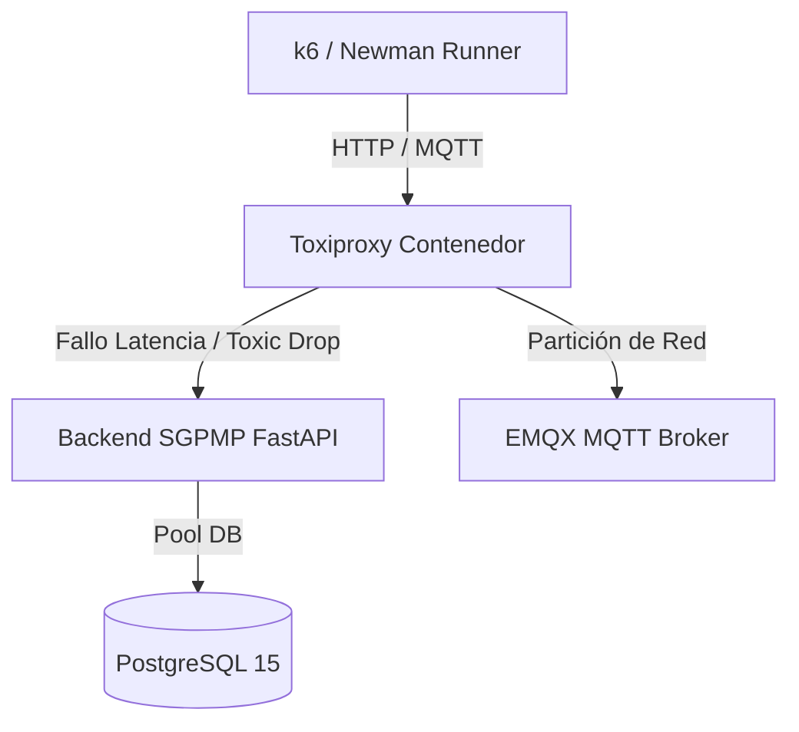

# DISENO_Y_PRECONDICIONES — TC-M03-G188

## 1. Identificación y Metadatos
- **ID Caso / Grupo:** TC-M03-G188 (TC-M03-357, TC-M03-358, TC-M03-359)
- **Módulo:** Módulo 3 — Telemetría, Infraestructura IoT y Bitácora de Auditoría
- **Requisito Funcional:** RF-63 (Bitácora de Auditoría IoT) — Resiliencia, Tolerancia a Fallos y Continuidad Operativa
- **Estado Global:** `[BLOQUEADO POR INFRAESTRUCTURA]`
- **Entorno Evaluado:** Backend TEST desplegado (`https://api.inmero.co/back-sigab-test`)

---

## 2. Justificación Técnica del Bloqueo
El caso de prueba G188 evalúa escenarios de resiliencia operativa y partición de red que son **físicamente imposibles de ejecutar o simular mediante peticiones API externas HTTPS**:

1. **TC-M03-357: Resiliencia ante Caída del Servicio / Repositorio de Auditoría:**
   - **Requisito:** Detener el servicio de bitácora o simular fallo irrecuperable en PostgreSQL mientras se ejecutan operaciones críticas de telemetría (RF-53).
   - **Motivo de Bloqueo:** El entorno TEST es un despliegue compartido gestionado en la nube. No existe acceso SSH/Docker ni permisos de orquestación para detener procesos de backend o corromper el motor de base de datos desde la capa cliente.
2. **TC-M03-358: Caída del Broker MQTT y Recuperación:**
   - **Requisito:** Detener el broker MQTT (`emqx` o `mosquitto`), forzar reconexiones continuas de sensores virtuales y evaluar cola persistente de mensajes.
   - **Motivo de Bloqueo:** El broker MQTT no expone API de control de ciclo de vida ni comandos de parada/reinicio accesibles para pruebas de automatización en TEST.
3. **TC-M03-359: Desconexión de Nodo Edge $\ge 2$ Horas y Buffer Local:**
   - **Requisito:** Aislar un gateway/edge durante más de 120 minutos, alterar el tamaño de búfer local mediante variables de entorno y medir la retransmisión idempotente.
   - **Motivo de Bloqueo:** El sandbox transaccional tiene un límite de vida estricto de 180 segundos. Una prueba de 2 horas satura el timeout del sandbox y causaría fallas catastróficas de concurrencia. Además, los nodos edge son dispositivos físicos o simuladores fuera del alcance de la API REST.

---

## 3. Propuesta de Arquitectura para Ejecución en Laboratorio Local
Para ejecutar estos 3 subcasos en etapas posteriores sin afectar entornos compartidos, se debe emplear un entorno de laboratorio basado en contenedores:

### Receta de Laboratorio Local (`docker-compose.test.yml`):
1. **Inyección de Fallas con Toxiproxy:**
   - Levantar servicio `ghcr.io/shopify/toxiproxy` intermedio entre el backend, el broker MQTT y PostgreSQL.
   - Usar la API REST de Toxiproxy para inyectar tóxicos de corte de conexión (`reset_peer`), latencia extrema o caída total (`bandwidth: 0`).
2. **Simulación de Caída de BD:**
   - Ejecutar comando Docker local: `docker compose stop db` durante la ingesta de telemetría y verificar si la cola en memoria o fallback a disco retiene los eventos.
3. **Simulación de Desconexión Edge:**
   - En un contenedor simulador de Edge en Python, configurar buffer SQLite local y cortar la interfaz virtual de red (`ip link set eth0 down`) por tiempo acelerado (usando un reloj virtual mock).
